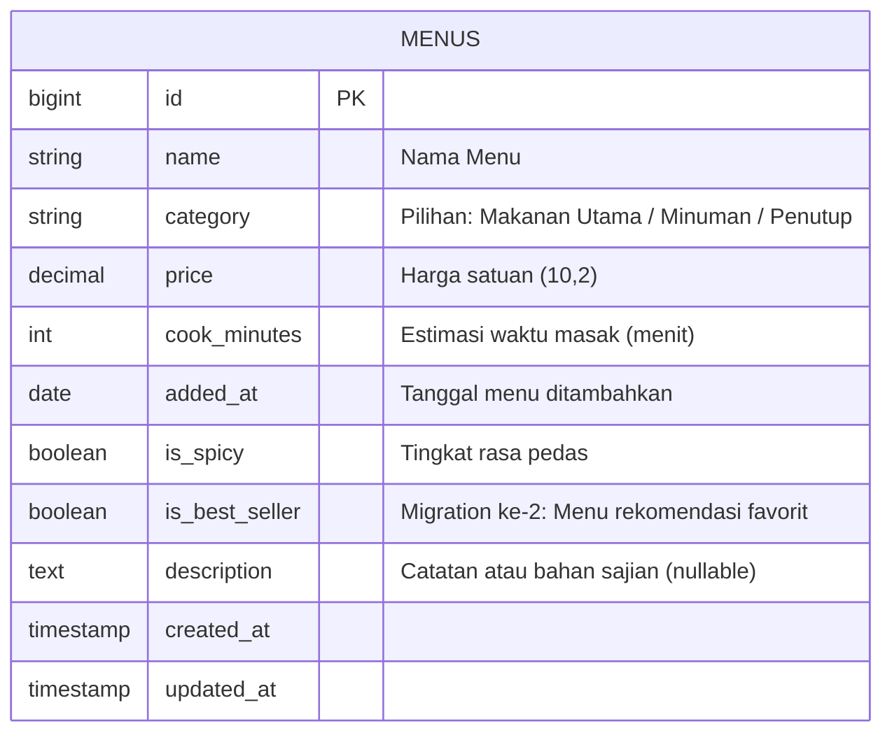

# Manajemen Menu Restoran (UTS Web Development)

Aplikasi web CRUD sederhana berbasis framework Laravel untuk pengelolaan menu hidangan restoran (makanan utama, minuman, dan makanan penutup) pada Resto Rasa Nusantara.

## Identitas Mahasiswa

| Parameter | Keterangan |
| :--- | :--- |
| **Nama Lengkap** | Fajrin Widianto |
| **NIM** | 2457401007 |
| **Digit Terakhir NIM** | 7 |
| **Tema** | Restoran |
| **Nama Aplikasi** | Manajemen Menu Restoran (Resto Rasa Nusantara) |
| **Nama Database** | `uts_2457401007` |
| **Nama Repository** | `uts-laravel-2457401007` |
| **Jumlah Data Seeder** | 17 data menu (`10 + 7`) |

---

## Struktur Tabel `menus` & ERD



### Rincian Kolom Tabel `menus`

| Nama Kolom | Tipe Data | Keterangan |
| :--- | :--- | :--- |
| `id` | `BIGINT UNSIGNED` | Primary Key, Auto Increment |
| `name` | `VARCHAR(255)` | Nama hidangan |
| `category` | `VARCHAR(255)` | Kategori (`Makanan Utama`, `Minuman`, `Penutup`) |
| `price` | `DECIMAL(10,2)` | Harga satuan hidangan |
| `cook_minutes` | `INTEGER` | Estimasi durasi masak dalam menit |
| `added_at` | `DATE` | Tanggal menu mulai dimasukkan |
| `is_spicy` | `BOOLEAN` | Indikator rasa pedas (`true`/`false`) |
| `is_best_seller` | `BOOLEAN` | Kolom tambahan dari migration ke-2 (default `false`) |
| `description` | `TEXT` | Deskripsi atau catatan penyajian (opsional/nullable) |
| `created_at` | `TIMESTAMP` | Waktu pembuatan data |
| `updated_at` | `TIMESTAMP` | Waktu modifikasi data terakhir |

---

## Panduan Instalasi & Menjalankan Project

### 1. Kloning Repository
```bash
git clone https://github.com/USERNAME/uts-laravel-2457401007.git
cd uts-laravel-2457401007
```

### 2. Instal Dependensi
```bash
composer install
```

### 3. Konfigurasi Environment
Salin file `.env.example` menjadi `.env`:
```bash
cp .env.example .env
```
Sesuaikan konfigurasi database pada `.env`:
```env
DB_CONNECTION=mysql
DB_HOST=127.0.0.1
DB_PORT=3306
DB_DATABASE=uts_2457401007
DB_USERNAME=root
DB_PASSWORD=
```

### 4. Generate Application Key
```bash
php artisan key:generate
```

### 5. Jalankan Migration & Seeder
```bash
php artisan migrate --seed
```

### 6. Jalankan Server Lokal
```bash
php artisan serve
```
Akses aplikasi melalui browser di: `http://127.0.0.1:8000`.

---

## Pengujian Otomatis (Feature Test)
Untuk menjalankan suite pengujian otomatis:
```bash
php artisan test --filter=MenuCrudTest
```
Semua 10 pengujian fitur CRUD, validasi, dan persistensi database terverifikasi lulus.
